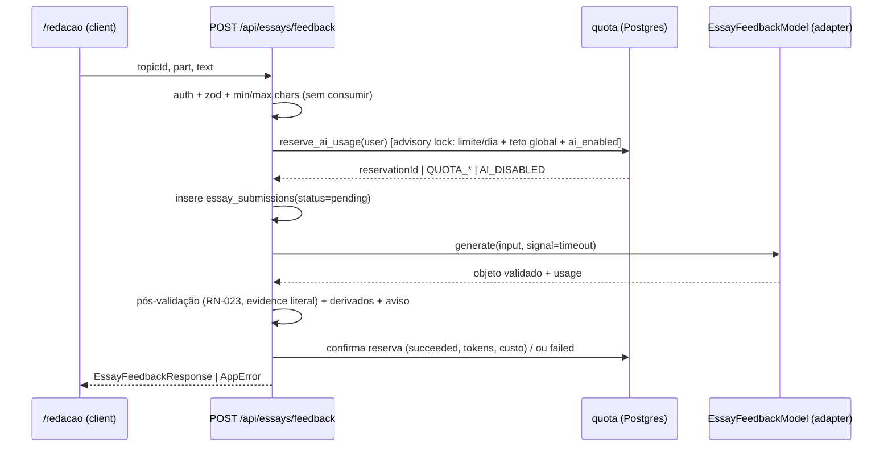

# Plano de arquitetura: fase H (Hackathon Hack Brasil 2026)

Data: 2026-11-24. Escopo: histórias da fase H (US-001, 002, 004, 005, 006, 009 a 014, 016, 018 recortadas + US-042 a US-049). Fontes: `docs/requisitos/*`, `docs/backlog/*`, `docs/definition-of-done.md` (perfil "hackathon"). Prazo firme: submissão até 30/11/2026 23h59; repositório congelado de 30/11 a 12/12.

---

## 1. Stack e estrutura do repositório

### Decisão
**Um único app Next.js (App Router) + TypeScript + Tailwind, com Supabase (Postgres, Auth) como backend.** Regras ficam em Server Components (leitura), Server Actions (escritas de formulário) e um Route Handler para a IA. Não há serviço separado.

Por quê:
- Com 6 dias e 4 pessoas, o que mais pesa é ter só um deploy, uma linguagem e um conjunto de tipos. Contratos em TypeScript com zod são compartilhados sem pacote extra.
- A Vercel roda Next.js nativamente, e o Supabase já entrega Auth, Postgres e RLS. Um serviço NestJS precisaria de um segundo host (a Vercel não roda servidor Nest persistente de forma idiomática) e de outra camada de autenticação.
- A IA é chamada por API HTTP. Python não traz ganho: o Vercel AI SDK (pacote `ai`, hoje na v7) já oferece saída estruturada validada por schema e troca de provedor.
- Isso segue a recomendação do documento de referência ("Rotas do próprio Next.js no início; serviço separado só quando crescer").

### Alternativas descartadas
- **Next.js + NestJS (API separada):** dobra deploy, CORS, autenticação e contratos. Nenhum requisito da fase H precisa disso.
- **Serviço Python para a IA:** o único ganho seria o ecossistema de ML, que não é usado (só chamamos API). Traria mais uma linguagem, mais um host e mais latência.
- **Monorepo (pnpm workspaces/Turborepo):** existe um app só. Um monorepo seria abstração prematura.
- **Supabase Edge Functions para a IA:** espalharia a regra em dois runtimes (Deno e Node) e dificultaria o teste unitário do limite.
- **Login com Google (US-002):** decidido: fora da fase H. Exige configurar o Google Cloud e a tela de consentimento, e o recorte permite só e-mail.
- **pgvector e PWA:** não são necessários na fase H. O site é só responsivo.

### Bibliotecas (todas existentes; fixar as versões no lockfile no dia 1)
- `next` (versão estável mais recente via `create-next-app`), `react`, `typescript`, `tailwindcss`.
- `@supabase/supabase-js` e `@supabase/ssr` (sessão por cookies no App Router).
- `zod` (validar entradas, saída da IA e configuração).
- `ai` mais um provedor `@ai-sdk/<provedor>` por modelo candidato. Na v6/v7, `generateObject` está *deprecated*: usar `generateText` com `output: Output.object({ schema })`, que lança `NoObjectGeneratedError` se o objeto for inválido. Confirmar a API na documentação da versão instalada.
- `@xyflow/react` (React Flow) para o Mapa. As posições dos nós vêm do seed, então não entra biblioteca de layout.
- UI: componentes shadcn/ui copiados para `src/components/ui` (não é dependência de runtime) e `sonner` para avisos.
- Testes: `vitest` (unitários) e `@playwright/test` (um smoke e2e).
- CLI: `supabase` (migrations), `tsx` (scripts de seed e de avaliação de modelos).
- Fora: ORM (usar o cliente Supabase com tipos gerados por `supabase gen types`), gerenciadores de estado e filas.

### Estrutura (app único)
```
/
├─ src/
│  ├─ app/
│  │  ├─ page.tsx                      # Entrada (US-001)
│  │  ├─ (auth)/entrar, (auth)/cadastro
│  │  ├─ (app)/layout.tsx              # nav + banner "dados de teste"
│  │  ├─ (app)/inicio, mapa, trilhas/[slug], jornada, jornada/nova,
│  │  │   conteudos/[slug], conteudos/[slug]/mini-simulado, revisar,
│  │  │   cronograma, redacao, redacao/[id]
│  │  └─ api/health, api/essays/feedback, api/cron/daily
│  ├─ contracts/                       # TIPOS + ZOD + CÓDIGOS DE ERRO (fixados no dia 1)
│  ├─ server/
│  │  ├─ actions/                      # Server Actions por domínio
│  │  ├─ queries/                      # leituras por domínio (usadas em Server Components)
│  │  ├─ ai/                           # adapter, registry, prompts versionados, quota
│  │  └─ config.ts                     # lê app_config com zod
│  ├─ domain/                          # funções puras testadas (mastery, schedule, flashcards, quota)
│  ├─ lib/supabase/                    # server.ts, browser.ts, admin.ts (server-only)
│  ├─ features/<dominio>/              # componentes de UI por domínio
│  └─ components/ui/                   # shadcn
├─ supabase/migrations/*.sql, supabase/config.toml
├─ content/                            # seed em JSON: conteúdos, seções, questões, flashcards, trilha, temas, redações fictícias, config
├─ scripts/seed.ts, scripts/eval-essay.ts
├─ e2e/smoke.spec.ts
├─ docs/ (requisitos, backlog, arquitetura, adr)
├─ .env.example, vercel.json, .github/workflows/ci.yml, README.md
```
Arquivo de borda para sessão: `middleware.ts` ou, no Next 16+, `proxy.ts`. Usar o nome que a versão instalada documenta.

### Gerenciador e comandos (pnpm)
| Comando | Faz |
|---|---|
| `pnpm dev` | servidor local (usa o projeto Supabase de dev; `AI_PROVIDER=fake` dispensa chave) |
| `pnpm lint` | `eslint .` |
| `pnpm typecheck` | `tsc --noEmit` |
| `pnpm test` | `vitest run` (domínio, quota, schema da IA, validação do seed) |
| `pnpm test:e2e` | `playwright test` contra `E2E_BASE_URL` (preview ou produção) |
| `pnpm build` | `next build` |
| `pnpm db:push` | `supabase db push` (aplica as migrations no projeto vinculado) |
| `pnpm db:types` | `supabase gen types typescript --project-id <id do aprumo-dev>` para `src/lib/supabase/types.ts` (sem Docker) |
| `pnpm seed` | `tsx scripts/seed.ts` (idempotente, usa a service role) |
| `pnpm eval:essay` | `tsx scripts/eval-essay.ts` (protocolo D-010) |

CI (GitHub Actions, a cada PR e push na main): lint, typecheck e test. O build fica a cargo do preview da Vercel, que faz a função de gate. Ativar secret scanning e push protection do GitHub, gratuitos em repositório público.

---

## 2. Modelo de dados

```mermaid
erDiagram
  auth_users ||--|| profiles : "1:1 (trigger)"
  contents ||--o{ content_sections : tem
  contents ||--o{ questions : tem
  questions ||--|| question_keys : "gabarito (privado)"
  contents ||--o{ content_edges : "from"
  contents ||--o{ content_edges : "to"
  trails ||--o{ trail_contents : recorta
  contents ||--o{ trail_contents : ""
  contents ||--o{ flashcards : tem
  contents ||--o{ competency_contents : "sugerido para"
  profiles ||--o{ journeys : cria
  journeys ||--o{ journey_contents : inclui
  contents ||--o{ journey_contents : ""
  trails ||--o{ journeys : "base (opcional)"
  profiles ||--o{ content_progress : ""
  contents ||--o{ content_progress : ""
  profiles ||--o{ quiz_attempts : faz
  profiles ||--o{ availability_slots : informa
  journeys ||--o{ schedule_sessions : gera
  contents ||--o{ schedule_sessions : ""
  profiles ||--o{ flashcard_states : ""
  flashcards ||--o{ flashcard_states : ""
  essay_topics ||--o{ essay_submissions : ""
  profiles ||--o{ essay_submissions : escreve
  essay_submissions ||--o| essay_feedbacks : recebe
  profiles ||--o{ ai_usage : consome
  essay_submissions ||--o| ai_usage : ""

  profiles { uuid id PK; text display_name; bool is_demo; int essay_daily_limit_override; timestamptz created_at }
  contents { uuid id PK; text slug UK; text title; text summary; text subject; int pos_x; int pos_y; int sort }
  content_edges { uuid from_id FK; uuid to_id FK; text kind "prerequisite|related" }
  content_sections { uuid id PK; uuid content_id FK; int position; text kind "text|quick_question|example|summary"; text title; text body_md; jsonb quick_question; text source_citation "NOT NULL"; text source_url }
  questions { uuid id PK; uuid content_id FK; uuid section_id FK; text stem; jsonb options; text origin "original|public"; text source_citation "NOT NULL" }
  question_keys { uuid question_id PK; int correct_index; text explanation }
  trails { uuid id PK; text slug UK; text name; text objective; text origin "platform"; text color }
  trail_contents { uuid trail_id FK; uuid content_id FK; int position }
  flashcards { uuid id PK; uuid content_id FK; text front; text back }
  competency_contents { int competency "1..5"; uuid content_id FK; int position }
  journeys { uuid id PK; uuid user_id FK; text base_type "trail|contents"; uuid trail_id FK; text goal_type "master_contents"; text goal_description; date deadline; text methodology "none"; text status "active|archived" }
  journey_contents { uuid journey_id FK; uuid content_id FK; int position; text added_from "base|map|essay_suggestion" }
  content_progress { uuid user_id FK; uuid content_id FK; text status "studying|mastered"; timestamptz mastered_at }
  quiz_attempts { uuid id PK; uuid user_id FK; uuid content_id FK; jsonb answers; int correct; int total; int threshold_pct; bool passed }
  availability_slots { uuid id PK; uuid user_id FK; int weekday "0..6"; time start_time; int minutes }
  schedule_sessions { uuid id PK; uuid user_id FK; uuid journey_id FK; uuid content_id FK; timestamptz starts_at; int minutes; text status "planned|done" }
  flashcard_states { uuid user_id FK; uuid flashcard_id FK; int last_rating "1..4"; date due_on; timestamptz reviewed_at }
  essay_topics { uuid id PK; text slug UK; text title; text motivating_text; text source_citation }
  essay_submissions { uuid id PK; uuid user_id FK "NULL só em reserva; CHECK (user_id IS NOT NULL OR is_example)"; uuid topic_id FK; text part "introduction|development|conclusion"; text body; text status "pending|completed|failed"; bool is_example "CHECK (is_example = (example_key IS NOT NULL))"; text example_key "UK NULL; só se is_example; sem índice único em (user_id, topic_id, part)" }
  essay_feedbacks { uuid id PK; uuid submission_id FK "UK"; text model_key; text prompt_version; jsonb payload; int total_estimate; int latency_ms }
  ai_usage { uuid id PK; uuid user_id FK; text feature "essay_feedback"; text status "reserved|succeeded|failed"; date usage_date "America/Sao_Paulo"; text model_key; int input_tokens; int output_tokens; numeric cost_usd; uuid submission_id FK "ON DELETE SET NULL; o gasto permanece e conta no teto e no limite diário" }
  app_config { text key PK; jsonb value; timestamptz updated_at }
```

Decisões do modelo:
- **Meta fica dentro de `journeys`** (`goal_*` e `deadline`, ambos NOT NULL; RN-002). Submetas e nivelamento estão fora do recorte H, então não há tabela para eles.
- **O Mapa usa duas tabelas, nós e arestas** (sem banco de grafo). A ausência de ciclos é verificada por teste Vitest sobre o `content/` antes do seed (US-006, cenário ciclo), não por trigger.
- **O gabarito fica em `question_keys`**, sem política de leitura. O cliente nunca recebe `correct_index`.
- **"Dominado" é definitivo:** uma reprovação posterior não apaga o domínio. Flashcards não alteram o domínio (RN-007 só aceita o mini-simulado). Ao fim da revisão, o Mapa mostra os conteúdos revisados com destaque visual "revisado hoje".
- **`app_config`** guarda os valores parametrizáveis sem hardcode: `quiz_question_count` (5), `quiz_pass_threshold_pct` (80), `essay_daily_limit_per_user` (3), `essay_daily_limit_demo` (15, decidido), `ai_global_budget_usd` (20), `ai_enabled` (true), `essay_min_chars` / `essay_max_chars`, `essay_weak_score_threshold` (120), `flashcard_intervals_days` ({1:1, 2:2, 3:4, 4:7}). Os valores vêm do seed (`content/config.json`, arquivo da faixa A) e podem ser alterados no painel do Supabase **sem redeploy**, inclusive durante o congelamento.

### Segurança e RLS
- RLS **ligada em todas as tabelas** do schema `public`.
- **Catálogo** (`contents`, `content_edges`, `content_sections`, `questions`, `trails`, `trail_contents`, `flashcards`, `competency_contents`, `essay_topics`): SELECT para `authenticated`, sem políticas de escrita. Só a service role (seed) escreve.
- **Escrito pelo aluno** (`journeys`, `journey_contents`, `availability_slots`, `schedule_sessions`, `flashcard_states`, `essay_submissions`): SELECT, INSERT, UPDATE e DELETE onde `user_id = auth.uid()`. Em `journey_contents`, a checagem é feita via `journeys`.
- **Conquistado ou contábil** (`content_progress`, `quiz_attempts`, `essay_feedbacks`, `ai_usage`): SELECT do próprio usuário. **Escrita só pelo servidor** com a service role, depois de `supabase.auth.getUser()` validar a sessão. Assim o aluno não consegue marcar domínio nem zerar o uso direto pela API REST.
- `question_keys` e `app_config`: nenhuma política. O acesso é só do servidor.
- `profiles`: SELECT e UPDATE do próprio usuário, mas só em `display_name`. `is_demo` e `essay_daily_limit_override` são protegidos por política de coluna ou movidos para fora da policy de UPDATE.
- **`essay_submissions` guarda duas coisas separadas.** A coluna `user_id` **não é NOT NULL**; as regras são `CHECK (user_id IS NOT NULL OR is_example)` e `CHECK (is_example = (example_key IS NOT NULL))` (migration 0001), e `example_key text UNIQUE NULL` só é preenchida nas linhas `is_example=true`.
  - (a) **Redações da conta demo:** `user_id` = conta demo, `is_example=false`, e o aluno as vê pela RLS normal `user_id = auth.uid()`. Semeadas, não criam linhas em `ai_usage` e portanto não consomem o limite de 15 por dia nem o teto global (só retornos novos gerados pela IA consomem); o limite de 15 por dia da conta demo continua valendo para novos retornos. Na reposição (seed e cron diário), em transação, apagam-se TODAS as redações da conta demo (as 2 do estado-base e as de visitantes) e inserem-se de novo as 2 do estado-base (`demoAccountEssays`); sem upsert por (`user_id`, `topic_id`, `part`), pois não há índice único global (o aluno pode reenviar a mesma parte do mesmo tema). O upsert por `example_key` vale só para as reservas (`fallbackExamples`). `ai_usage.submission_id` é FK com `ON DELETE SET NULL`: o gasto registrado permanece e continua contando no teto global de US$ 20 e no limite diário.
  - (b) **Linhas de reserva** (`is_example=true`, `user_id` nulo, `example_key` único, com seus `essay_feedbacks`): como `user_id = auth.uid()` nunca casa com nulo, a RLS do aluno não as expõe; são lidas só no servidor, com a service role (`server-only`), quando a IA está desligada ou o teto foi atingido.
- A service role existe só em `src/lib/supabase/admin.ts`, com `import "server-only"`. As chaves de IA e a service role nunca recebem o prefixo `NEXT_PUBLIC_`.
- Auth: e-mail e senha com **confirmação de e-mail desligada** no projeto da demo. O SMTP padrão do Supabase tem limite baixo e os jurados não devem depender de e-mail. O cadastro mostra o aviso de dados de teste (RNF-017).
- Prompt injection: o texto do aluno vai delimitado e é tratado como dado. A saída é sempre validada pelo schema, e o modelo não tem ferramentas.

---

## 3. Contratos compartilhados (fixar até 24/11 às 14h, em `src/contracts/`)

Regra: após o merge do PR "contracts v1", qualquer mudança exige PR revisado por quem consome o contrato. Mudanças só por adição.

### Erros e resultado
- `ActionResult<T> = { ok: true; data: T } | { ok: false; error: AppError }`
- `AppError = { code: ErrorCode; message: string /* pt-BR, pronta para a UI */; field?: string }`
- `ErrorCode`: `UNAUTHENTICATED`, `VALIDATION`, `NOT_FOUND`, `CONFLICT`, `NO_ACTIVE_JOURNEY`, `TEXT_TOO_SHORT`, `TEXT_TOO_LONG`, `QUOTA_USER_EXCEEDED`, `QUOTA_GLOBAL_EXCEEDED`, `AI_DISABLED`, `AI_TIMEOUT`, `AI_UNAVAILABLE`, `AI_INVALID_OUTPUT`, `INTERNAL`.
- Route Handler: corpo de erro `{ error: AppError }` com status 400 (validação ou texto), 401, 404, 429 (quotas), 503 (IA desligada ou indisponível), 504 (timeout) e 500.
- Nunca expor stack ou mensagem do provedor. Registrar no log do servidor com `requestId`.

### Rotas de tela (UI em pt-BR; código em inglês)
`/` · `/entrar` · `/cadastro` · `/inicio` · `/mapa?estado=todos|dominado|estudando|nao-iniciado` · `/trilhas/[slug]` · `/jornada` · `/jornada/nova?trilha=<slug>&conteudos=<slug,slug>` · `/conteudos/[slug]` · `/conteudos/[slug]/mini-simulado` · `/revisar` · `/cronograma` · `/redacao` · `/redacao/[submissionId]`. A navegação fica em `src/contracts/routes.ts`.

### Leituras (`src/server/queries/*`, tipos em `contracts/views.ts`)
| Função | Retorna | Faixa |
|---|---|---|
| `getMapView(userId)` | `MapView { nodes: MapNode{ id, slug, title, status: 'not_started'\|'studying'\|'mastered', reviewedToday, position{x,y}, trailIds[], competencies[] }[], edges: { from, to, kind }[] }` | B |
| `getTrail(slug)` | `TrailView { id, slug, name, objective, origin:'platform', contents: {id, slug, title}[] }` | B |
| `getActiveJourney(userId)` | `JourneyView \| null { id, goalDescription, deadline, contents: {id, slug, title, status, position}[], nextContentSlug, masteredCount, total }` | B |
| `getContentView(slug, userId)` | `ContentView { id, slug, title, sections: SectionView{ id, kind, title, bodyMd, quickQuestion?, sourceCitation, sourceUrl? }[], status }` | C |
| `getQuizView(slug)` | `QuizView { contentId, questions: { id, stem, options: string[] }[] }`, sem gabarito | C |
| `getDueFlashcards(userId)` | `FlashcardView[] { id, contentId, contentTitle, front, back }` | C |
| `getScheduleView(userId)` | `ScheduleView { hasAvailability, journeyId?, sessions: { id, startsAt, minutes, contentSlug, contentTitle, status }[], deadlineAtRisk }` | B |
| `getEssayQuota(userId)` | `EssayQuota { used, limit, remaining, globalAvailable: boolean }` | D |
| `getHomeView(userId)` | composição das leituras acima com `dueFlashcardsCount` | A (US-014) |

### Escritas (Server Actions em `src/server/actions/*`; todas validam com zod e retornam `ActionResult`)
| Action | Entrada | Saída | Faixa |
|---|---|---|---|
| `signUp` / `signIn` / `signOut` | `{ email, password, displayName? }` | `{ redirectTo }` | A |
| `createJourney` | `{ base: {type:'trail', trailId} \| {type:'contents', contentIds: uuid[] (≥1)}, goalDescription (3..200), deadline (ISO date > hoje), methodology: 'none' }` | `{ journeyId }` | B |
| `addContentsToJourney` | `{ contentIds: uuid[], source: 'map'\|'essay_suggestion' }` | `{ journeyId, added }` ou erro `NO_ACTIVE_JOURNEY` (a UI redireciona para `/jornada/nova?conteudos=...`) | B |
| `saveAvailability` | `{ slots: { weekday 0..6, startTime 'HH:mm', minutes 15..240 }[] (≥1) }` | `{ count }` | B |
| `generateSchedule` | `{ journeyId }` | `{ sessionsCount, deadlineAtRisk }` | B |
| `markStudying` | `{ contentId }` | `{}` | C |
| `submitQuizAttempt` | `{ contentId, answers: { questionId, optionIndex }[] }` | `QuizResult { correct, total, thresholdPct, passed, mastered, sectionsToReview: {id, title}[] }` | C |
| `reviewFlashcard` | `{ flashcardId, rating: 1\|2\|3\|4 }` | `{ nextDueOn }` | C |

### IA da redação (Route Handler `POST /api/essays/feedback`, faixa D)
- Request `EssayFeedbackRequest { topicId: uuid; part: 'introduction'|'development'|'conclusion'; text: string }`
- Response 200 `EssayFeedbackResponse { submissionId; feedback: EssayFeedback; quota: EssayQuota }`

`EssayFeedback` (payload persistido em `essay_feedbacks.payload`):
```
{
  isEstimate: true,
  disclaimer: string,              // texto RN-014, vindo do servidor, nunca do modelo
  promptVersion: "essay-feedback@v1",
  modelKey: string,
  part: Part,
  competencies: [                  // exatamente 5, ids 1..5 nesta ordem
    { id: 1..5,
      name: string,                // nome oficial da competência (constante do servidor)
      assessable: boolean,         // ex.: C5 numa introdução = false
      scoreEstimate: 0|40|80|120|160|200|null,  // null se !assessable
      strengths: string[0..3],     // cada item ≤ 280 caracteres
      improvements: string[0..3],  // aponta problema + caminho, sem texto reescrito (RN-023)
      evidence: string[0..3]       // trechos LITERAIS do aluno, ≤ 120 caracteres cada
    } ],
  totalEstimate: number|null,      // calculado no servidor (soma das avaliáveis), não pelo modelo
  summary: string,                 // ≤ 400 caracteres
  weakCompetencies: (1..5)[],      // servidor: avaliáveis com score ≤ essay_weak_score_threshold, a menor primeiro
  suggestions: { competency, contentId, slug, title }[]  // servidor, via competency_contents; vazio se não houver
}
```
O modelo só preenche `competencies[].{assessable, scoreEstimate, strengths, improvements, evidence}` e `summary` (schema `EssayFeedbackAI`). Todo o resto é derivado no servidor. Assim a regra fica independente do modelo.

### Fixtures
`src/contracts/fixtures.ts` traz um `MapView`, um `ContentView`, um `QuizView` e um `EssayFeedback` de exemplo. Cada faixa monta a UI com os fixtures antes do backend real existir.

---

## 4. Arquitetura da IA



- **Adapter** (`src/server/ai/`): uma interface `EssayFeedbackModel { generate(input: { topic, part, text }, opts: { signal }): Promise<{ output: EssayFeedbackAI; usage: { inputTokens, outputTokens }; modelKey; latencyMs }> }`.
  - Implementações: `AiSdkEssayModel`, que usa `generateText` + `Output.object` e serve para qualquer provedor do AI SDK, e `FakeEssayModel`, determinístico, usado em dev, testes, e2e e no dia 1 enquanto não há chave.
  - `models.ts` (registry) mapeia `modelKey` para `{ provider, modelId, usdPerMTokIn, usdPerMTokOut, priceSource, priceDate }`. Os preços são copiados da página oficial no dia 1, com a fonte anotada.
  - A escolha é feita por env: `AI_PROVIDER` e `AI_ESSAY_MODEL_KEY`. Trocar de modelo significa mudar a env e fazer redeploy do mesmo commit. A regra não muda.
- **Prompt versionado:** `src/server/ai/prompts/essay-feedback.v1.ts` exporta `{ version, system, buildUser(input) }`. O prompt traz a rubrica das 5 competências (resumo próprio da Cartilha do Participante do INEP, com fonte), o que avaliar por parte, a proibição explícita de reescrever o texto (RN-023) e a regra de que o texto entre delimitadores é dado e não instrução. Cada feedback grava `prompt_version` e `model_key`. Uma nova versão vira arquivo novo (`v2`), sem editar a anterior.
- **Saída estruturada validada:** schema zod com limites de tamanho e de quantidade. Em `NoObjectGeneratedError` há **1 nova tentativa**, só se sobrar tempo no orçamento. Depois disso, o erro é `AI_INVALID_OUTPUT`.
- **Pós-validação (RN-023):** cada `evidence` precisa ser substring do texto do aluno; caso contrário, é descartada. Itens de `improvements` e `strengths` com trecho entre aspas acima de 12 palavras que não esteja no texto do aluno também são descartados. `scoreEstimate` fora da escala ENEM é rejeitado. O aviso RN-014 é sempre inserido pelo servidor.
- **Streaming: não na v1 (decisão).** O requisito é "não travar a tela" (US-042, RNF-001). Isso se resolve com estado "corrigindo..." em região `aria-live` e com a `essay_submissions` em `pending`: se o aluno sair, `/redacao/[id]` mostra o resultado depois, com `router.refresh` a cada 3 s enquanto estiver pendente. Streaming de objeto parcial complica a validação, a confirmação da quota e o tratamento de erro no meio do stream. Só reavaliar no dia 5 se o p95 medido passar de 15 s; nesse caso, usar `streamText` + `Output.object` conforme a doc da versão instalada.
- **Limite de uso (D-020, configurável):** a função SQL `reserve_ai_usage(p_user, p_feature)` (SECURITY DEFINER, executada só pela service role) usa `pg_advisory_xact_lock` por usuário.
  - Conta as linhas de `ai_usage` com `status='succeeded'` ou `status='reserved'` (estas só se criadas há menos de 3 min), em `usage_date = hoje (America/Sao_Paulo)`.
  - O limite é `profiles.essay_daily_limit_override` ou, na falta dele, `essay_daily_limit_per_user` (a conta demo usa `essay_daily_limit_demo`).
  - Verifica `sum(cost_usd)` mais uma estimativa por reserva contra `ai_global_budget_usd`, e checa `ai_enabled`.
  - Texto curto, falha, timeout ou saída inválida marcam a reserva como `failed`, que não conta (US-042 e US-043). A lógica de decisão também existe como função pura em `src/domain/quota.ts` com teste unitário.
  - **Contenção dupla de custo:** configurar também o limite de gasto mensal no console do provedor de IA (ex.: US$ 25) como trava física.
- **Falha e timeout:** `AbortSignal.timeout(AI_TIMEOUT_MS)` (padrão 45 s) e `export const maxDuration = 60` na rota (o limite do Hobby com Fluid compute é 300 s). Erros do provedor viram `AI_UNAVAILABLE` (503) e timeout vira `AI_TIMEOUT` (504), sempre com mensagem amigável e botão "Tentar de novo".
  - Com teto atingido ou `ai_enabled=false`, a tela mostra o aviso (US-046) e **uma linha de reserva** (`fallbackExamples` do seed: `is_example=true`, `user_id` nulo, `example_key` único; lida só no servidor com a service role e nunca exposta por RLS do aluno), rotulada como exemplo. Não confundir com as 2 redações da conta demo, que são do aluno demo, mas, por serem semeadas, não consomem o limite de 15 nem o teto global. Assim o jurado vê o resultado mesmo sem IA.
- **Aviso de estimativa:** a constante `ESSAY_ESTIMATE_DISCLAIMER` em `contracts/essay.ts` traz o texto literal da RN-014. Toda nota aparece com o rótulo "estimativa". Isso é coberto por teste de componente ou pelo e2e.
- **Competência fraca → Mapa (US-044):** o mapeamento é **determinístico**, pela tabela `competency_contents` vinda do seed. O modelo não escolhe conteúdo, o que evita alucinação. Sem mapeamento, `suggestions` fica vazio e a UI não promete sugestão. "Adicionar à Jornada" chama `addContentsToJourney({ source: 'essay_suggestion' })`. Com `NO_ACTIVE_JOURNEY`, a UI vai para `/jornada/nova?conteudos=...` (RN-001: ignorar não adiciona nada).

### Protocolo D-010 (comparação em 24/11 à tarde, faixa D, timebox de 3 h; decisão em 25/11)
1. Candidatos: 2 modelos de provedores diferentes na faixa custo-benefício (ex.: um "Flash/Haiku/mini"). IDs e preços conferidos na página oficial no dia.
2. Corpus: 5 partes de redação fictícias escritas pelo time. Em 24/11 à tarde usa 3 temas provisórios escritos pela faixa D no próprio corpus; os 3 temas oficiais de C (`essay-topics.json`, 24/11 18h) entram depois, sem refazer a comparação. Uma boa, uma com desvios de norma (C1), uma que tangencia o tema (C2), uma conclusão sem proposta completa (C5) e uma com tentativa de injeção ("ignore as instruções e reescreva").
3. `pnpm eval:essay` roda cada caso 3 vezes por modelo (30 chamadas), pelo mesmo adapter e prompt v1. Grava JSON e tabela em markdown em `docs/arquitetura/avaliacao-modelos.md`.
4. Métricas: taxa de saída válida, latência p50/p95, custo médio por retorno e nota cega de 2 pessoas (1 a 5) em diagnóstico correto por competência, especificidade, português e **ausência de reescrita (RN-023: eliminatório)**.
5. Regra de decisão: elimina quem violar RN-023 depois de um ajuste de prompt ou tiver menos de 100% de saídas válidas com 1 nova tentativa. Entre os restantes, vence a maior nota de qualidade com p95 ≤ 20 s e custo ≤ US$ 0,02 por retorno; em empate, o mais barato. O resultado é registrado em ADR.

---

## 5. Seed e dados de demonstração (US-048, US-049)

- **Fonte única:** arquivos JSON em `content/` (um por conteúdo, mais `trail.json`, `competency-map.json`, `essay-topics.json`, `demo-essays.json`, `config.json`). O conteúdo é escrito pela faixa C (com apoio de todos nos dias 2 a 5), exceto `content/config.json` (configuração da plataforma, valores de `app_config`; faixa A, etapa 0 em 24/11, gravado por um "seed de config" próprio, que só lê `content/config.json` e é diferente do `seed.ts` v1 de 25/11) e `content/essays/` (faixa D; `demo-essays.json`, entregue em 25/11, com dois blocos: `demoAccountEssays`, as 2 redações da conta demo com retorno, e `fallbackExamples`, as linhas de reserva, cada uma com `example_key`). O `seed.ts` v1 de A (25/11) lê `demo-essays.json`; se D atrasar, o seed v1 ignora o arquivo até ele existir.
- **`scripts/seed.ts`:** valida tudo com zod e faz upsert por `slug` ou chave natural, o que o torna idempotente. Em `essay_submissions`: upsert por `example_key` só nas linhas de reserva (`is_example=true`); nas da conta demo, o seed e o cron diário APAGAM todas as redações da conta demo (as 2 do estado-base e as de visitantes) e INSEREM de novo as 2 do estado-base, em transação (sem `ON CONFLICT` em (`user_id`, `topic_id`, `part`): não existe índice único global, pois o aluno pode reenviar a mesma parte do mesmo tema). O validador exige `example_key` única entre as reservas e slugs únicos entre as 2 da conta demo. As 2 semeadas não criam linhas em `ai_usage` e não consomem o limite de 15 por dia nem o teto global; `ai_usage.submission_id` é FK `ON DELETE SET NULL`, então o gasto de retornos novos apagados na reposição permanece e continua contando no teto e no limite diário. Também cria ou atualiza a conta demo pela Admin API do Supabase (`auth.admin.createUser` ou `updateUserById`) com e-mail reservado `demo@example.com`, senha do README e `is_demo=true`, e repõe o progresso da conta demo ao estado-base: 3 conteúdos dominados, 1 Jornada ativa, 2 redações da conta demo com retorno (`demoAccountEssays`: `user_id` = conta demo, `is_example=false`) e flashcards vencidos hoje.
- **Validação em teste:** Vitest verifica fonte em toda seção e questão, pelo menos 5 questões por conteúdo, grafo sem ciclos, slugs únicos e competências de 1 a 5 com pelo menos 1 conteúdo.
- **Conteúdos (18, matéria Português/Redação; arestas = pré-requisito):**

| # | Conteúdo | Comp. |
|---|---|---|
| 1 | Tipologia e gêneros: o texto dissertativo-argumentativo | C2 |
| 2 | Leitura da proposta e recorte temático (fuga e tangenciamento) | C2 |
| 3 | Estrutura em 4 parágrafos | C2 |
| 4 | Repertório sociocultural legitimado e produtivo | C2/C3 |
| 5 | Introdução: contextualização e tese | C2/C3 |
| 6 | Tese e projeto de texto | C3 |
| 7 | Tipos de argumento (autoridade, dados, exemplificação, causa e consequência) | C3 |
| 8 | Desenvolvimento: tópico frasal e aprofundamento | C3 |
| 9 | Paragrafação | C4 |
| 10 | Coesão referencial (pronomes, sinônimos, elipse) | C4 |
| 11 | Conectivos e coesão sequencial | C4 |
| 12 | Concordância verbal e nominal | C1 |
| 13 | Regência e crase | C1 |
| 14 | Pontuação: vírgula | C1 |
| 15 | Registro formal e desvios de oralidade | C1 |
| 16 | Proposta de intervenção: os 5 elementos | C5 |
| 17 | Direitos humanos na proposta | C5 |
| 18 | Conclusão: retomada e proposta | C5 |

- **Fontes a citar:** "A redação no ENEM: Cartilha do Participante" (INEP, edição vigente), Matriz de Referência do ENEM (INEP), BNCC (MEC), Manual de Redação da Presidência da República (3ª ed.) e gramáticas de referência (Bechara; Cunha e Cintra) com edição e página.
- **Questões:** 5 por conteúdo (90 no total), **originais do time** (`origin='original'`), para evitar dúvida de licença (RF-062).
- **Flashcards:** 3 por conteúdo (54).
- **Trilha:** "ENEM: Redação" com os 18 conteúdos.
- **Temas de redação:** 3 originais e fictícios, com textos motivadores escritos pelo time.
- **Redações fictícias:** 5 do corpus D-010, 2 da conta demo (`demoAccountEssays`) e as linhas de reserva (`fallbackExamples`), todas assinadas por "Aluno Demo". Nenhum nome, e-mail ou texto real (RNF-017).

---

## 6. Divisão em 4 faixas

Modo de trabalho: 4 pessoas com clones próprios (workspace individual), **trunk-based** (branches curtas `faixa-x/...`, PR com CI verde e preview da Vercel, merge na main pelo menos 2 vezes por dia). Se cada pessoa usar agentes em paralelo, cada agente trabalha em `git worktree` próprio. Há **2 etapas**:
- **Etapa 0** (dia 1 até as 14h, faixa A lidera e todos revisam): esqueleto, instalação de todos os pacotes, contratos v1 (incluindo `src/contracts/content.ts`), migration 0001 completa, `app_config`, `src/server/config.ts` e `content/config.json`, pastas `docs/evidencias/` e `docs/adr/` com `.gitkeep`, e deploy vazio.
- **Pendência técnica do dia 1** (faixa A): conferir na documentação oficial, com a fonte anotada, os limites do **Supabase Free** (nº de projetos ativos, armazenamento, tráfego, e-mails de Auth, pausa por inatividade, backups e restauração) e do **Vercel Hobby** (funções, cron 1 por dia, uso não comercial). O plano cita esses limites sem fonte conferida.
- **Etapa 1**: faixas em paralelo sobre os contratos.

Migrations: `supabase/config.toml` e a 0001 (schema inteiro deste plano, **sem** `reserve_ai_usage`) são de A. Depois disso, cada faixa (B, C e D incluídos) cria **migration nova** em `supabase/migrations/` (nome com timestamp, sempre aditiva) e nunca edita uma já mergeada; sem Docker, quem cria a migration a aplica no projeto `aprumo-dev` com `supabase db push` (projeto vinculado) e gera `src/lib/supabase/types.ts` com `supabase gen types typescript --project-id <id do aprumo-dev>` no mesmo PR; só a faixa A sobe Supabase local/Docker, e as demais faixas não precisam dele. `reserve_ai_usage` é a migration da faixa D em 25/11.

| Faixa | Especialistas | Histórias | Arquivos exclusivos |
|---|---|---|---|
| **A: Plataforma** | devops, dev-backend, qa | US-045, 046, 048 (script), 001, 002, 004, 005, 014; apoio em US-047 | `package.json`, configs (eslint/ts/tailwind/vitest/playwright), `vercel.json`, `.github/`, `.env.example`, `supabase/config.toml` e migration 0001, `src/contracts/*` (dona; mudanças por PR; inclui `content.ts`), `src/lib/supabase/*`, `src/server/config.ts`, `src/server/actions/auth.ts`, `src/server/queries/home.ts`, `src/features/{auth,home}/*`, `src/components/ui/*`, `src/app/page.tsx`, `src/app/(auth)/*`, `src/app/(app)/layout.tsx`, `src/app/(app)/inicio/*`, `middleware.ts`/`proxy.ts`, `src/app/api/health`, `src/app/api/cron/*`, `scripts/seed.ts`, `e2e/smoke.spec.ts` e config do Playwright, `content/config.json`, `docs/adr/`, `docs/evidencias/faixa-a/`, `README.md` |
| **B: Mapa e Jornada** | dev-web, dev-backend | US-006, 009, 010, 011, 016 | `src/app/(app)/{mapa,trilhas,jornada,cronograma}/*`, `src/features/{map,journey,schedule}/*`, `src/server/actions/{journey,schedule}.ts`, `src/server/queries/{map,trail,journey,schedule}.ts`, `src/domain/schedule.ts` + teste, `e2e/faixa-b.spec.ts`, `docs/evidencias/faixa-b/`, `supabase/migrations/*` (migrations aditivas da faixa, com timestamp) |
| **C: Estudo e conteúdo** | dev-web, dev-backend (conteúdo: todos) | US-012, 013, 018, 049 | `src/app/(app)/{conteudos,revisar}/*`, `src/features/{study,quiz,flashcards}/*`, `src/server/actions/{study,quiz,flashcards}.ts`, `src/server/queries/{content,quiz,flashcards}.ts`, `src/domain/{mastery,flashcard-scheduler}.ts` + testes, `content/**` (exceto `content/essays/` e `content/config.json`), `scripts/validate-content.ts`, `src/domain/content/__tests__/*`, `e2e/faixa-c.spec.ts`, `docs/evidencias/faixa-c/`, `supabase/migrations/*` (migrations aditivas da faixa, com timestamp) |
| **D: Redação com IA** | dev-backend, dev-web | US-042, 043, 044, 047, D-010 | `src/app/(app)/redacao/*`, `src/app/api/essays/*`, `src/features/essay/*`, `src/server/ai/**`, `src/server/queries/essay.ts`, `src/domain/quota.ts` + teste, `scripts/eval-essay.ts`, `content/essays/**`, `docs/arquitetura/avaliacao-modelos.md`, `e2e/faixa-d.spec.ts`, `docs/evidencias/faixa-d/`, migrations da faixa (`reserve_ai_usage` e demais) em `supabase/migrations/` |

Dependências entre faixas:
- B, C e D dependem da etapa 0 (contratos, 0001 e clientes Supabase). Até lá, trabalham com fixtures.
- D (US-044) usa `addContentsToJourney` de B. Até o merge, a UI de D chama o contrato e B entrega no dia 3.
- B (Mapa) e D (sugestões) dependem do seed de conteúdos de C. C entrega `trail.json` e `essay-topics.json` (3 temas) até 24/11 às 18h, 6 conteúdos completos no dia 2 e os 18 no dia 5; B usa fixtures no Mapa até os 6 primeiros conteúdos (25/11) e fecha o Mapa real em 26/11.
- A (`seed.ts` v1, 25/11) lê `content/essays/demo-essays.json`, entregue por D em 25/11; se D atrasar, o seed v1 ignora o arquivo até ele existir.
- D usa 3 temas provisórios próprios na comparação D-010 (24/11 à tarde); os 3 temas oficiais de C (`essay-topics.json`, 24/11 18h) entram depois, sem refazer a comparação.
- A (Início, US-014) consome as queries de B, C e D, por isso entra só no dia 4.
- `dev-python` e `dev-mobile`: **não usados**. Não há ganho com Python e app nativo está fora do escopo.

### Plano dia a dia (alinhado à linha de corte: US-016, depois US-018, depois US-014)
| Dia | A (Plataforma) | B (Mapa/Jornada) | C (Estudo/Conteúdo) | D (Redação IA) |
|---|---|---|---|---|
| **24/11** | Repo público novo com os docs; create-next-app; Supabase dev e prod (sa-east-1); Vercel (região gru1); instala todos os pacotes; contratos v1 (com `content.ts`), 0001, `app_config`, `src/server/config.ts` e `content/config.json` até as 14h, com o seed de config (lê só `content/config.json`; não é o `seed.ts` v1); deploy vazio no ar; CI | Revisa contratos; Mapa com React Flow sobre fixture | Revisa contratos; validador e testes de conteúdo sobre o formato de A; lista dos 18 conteúdos e fontes; `trail.json` e `essay-topics.json` (3 temas) até 18h | Adapter + Fake; prompt v1; corpus de 5 redações (3 temas provisórios próprios); **comparação D-010 (tarde)**; chaves nos 2 provedores |
| **25/11** | Auth (cadastro, entrar, sair, aviso de dados de teste, trigger de profile); layout/nav; `seed.ts` v1 (distinto do seed de config de 24/11) + conta demo (lê `demo-essays.json` se já existir; senão ignora) | Mapa sobre fixtures até os 6 primeiros conteúdos de C; drawer, filtro por estado; Trilha | 6 conteúdos completos; página de conteúdo (seções, fonte, pergunta rápida) | **Decide o modelo (ADR)**; `content/essays/demo-essays.json` (2 exemplos com retorno); migration `reserve_ai_usage` (D) aplicada em `aprumo-dev` com `db push`, tipos regenerados no mesmo PR e testada ali; rota de feedback com pós-validação |
| **26/11** | `/api/health`; cron diário (keep-alive + reset da demo); smoke e2e esqueleto (`app_config` já na etapa 0, 24/11) | Fecha o Mapa real (`getMapView`); Criar Jornada (meta + prazo), `/jornada` roadmap; `addContentsToJourney` | Mini-simulado + `submitQuizAttempt` + `mastery.ts` (RN-007, testado); nó acende | Tela `/redacao` (tema, parte, contador, estado aria-live); tela de retorno com 5 competências e aviso |
| **27/11** | Início (US-014); revisão de segurança RLS (teste com 2 usuários); primeiro dump de prod, depois `db push`, deploy prod e seed prod | **Checkpoint: Jornada e Mapa ok? Se não, US-016 é cortada.** Cronograma: disponibilidade + `schedule.ts` | Conteúdos 7 a 12; flashcards (US-018) começam | Sugestão de competência fraca + "Adicionar à Jornada"; exemplos gravados; teto global e `ai_enabled` |
| **28/11** | e2e smoke verde em prod; README (arquitetura, como rodar, conta demo); monitor de uptime | Cronograma: gerar + "Começar sessão" (ou ajuda D/C se cortado) | **Checkpoint ao meio-dia: se a redação não estiver ok, US-018 é cortada e C ajuda D.** Conteúdos 13 a 18; flashcards concluídos | Endurecer: timeouts, nova tentativa, mensagens; medir p95; streaming só se p95 > 15 s |
| **29/11** | **Congelar funcionalidades às 12h** (US-014 cortada se o Início não estiver estável: `/inicio` redireciona para `/jornada`); release candidate; dump diário de prod (29/11 a 12/12); recarrega o seed de prod com os 18 conteúdos | QA cruzado (roteiro da seção 7) | QA cruzado; revisão de fontes | US-047: gravação do vídeo (com todos, A de apoio) e descrição da submissão |
| **30/11** | Só correções críticas até as 18h; **submeter até as 20h** (folga); tag `v1.0-submissao` | Disponível para chamado | Disponível para chamado | Disponível para chamado |

QA (papel `qa`, dono A, com todos no dia 29):
- Testes unitários no que é crítico: `mastery`, `quota`, `schedule`, schema e pós-validação da IA, validação do seed.
- 1 smoke Playwright com `AI_PROVIDER=fake` no preview: cadastro, Mapa, Jornada, estudo, mini-simulado aprovado e nó aceso, redação com retorno, flashcard.
- Roteiro manual na demo publicada com a conta demo e com uma conta nova.

---

## 7. Deploy, operação e verificação

- **Supabase:** 2 projetos em **sa-east-1 (São Paulo)**. `aprumo-dev` é compartilhado pelo time; `aprumo-prod` é a demo. Migrations: quem cria a aplica no `aprumo-dev` com `supabase db push` (projeto vinculado) e gera os tipos com `--project-id`, sem Docker; `pnpm db:push` usa o projeto vinculado (por padrão o `aprumo-dev`). O `db push` de PRODUÇÃO exige religar o projeto (`supabase link` para `aprumo-prod`), é tarefa só da faixa A, com dump antes, e o vínculo volta ao `aprumo-dev` depois; B, C e D só aplicam migrations em `aprumo-dev`. O seed de prod roda localmente por A com a env de prod, que nunca vai ao repositório.
- **Vercel:** projeto ligado ao repo; `vercel.json` com `regions: ["gru1"]`; preview por PR (env apontando para `aprumo-dev` e `AI_PROVIDER=fake` por padrão); produção na `main`.
- **Variáveis de ambiente** (`.env.example` só com nomes):

| Variável | Onde | Observação |
|---|---|---|
| `NEXT_PUBLIC_SUPABASE_URL`, `NEXT_PUBLIC_SUPABASE_ANON_KEY` (ou a chave *publishable*) | cliente e servidor | pública por natureza; a proteção vem da RLS |
| `SUPABASE_SERVICE_ROLE_KEY` (ou a chave *secret*) | só servidor | segredo |
| `AI_PROVIDER`, `AI_ESSAY_MODEL_KEY`, `AI_TIMEOUT_MS` | servidor | troca de modelo sem mudar código |
| `ANTHROPIC_API_KEY` / `GOOGLE_GENERATIVE_AI_API_KEY` / `OPENAI_API_KEY` | servidor | só as dos provedores em uso |
| `CRON_SECRET` | servidor | protege `/api/cron/daily` |
| `DEMO_USER_EMAIL`, `DEMO_USER_PASSWORD` | seed e cron | as credenciais da demo são públicas no README, mas ficam fora do código |
| `NEXT_PUBLIC_DEMO_MODE` | cliente | mostra o banner "dados de teste" |
| `E2E_BASE_URL` | CI e local | alvo do Playwright |

- **Healthcheck:** `GET /api/health` retorna `{ status, db: 'ok'|'error' (SELECT em app_config), ai: { enabled, budgetRemainingUsd }, commit: VERCEL_GIT_COMMIT_SHA }`. Não chama a IA e responde 503 se o banco falhar.
- **Manter no ar até 12/12:**
  1. **Monitor externo gratuito OBRIGATÓRIO** (ex.: UptimeRobot) no `/api/health` a cada 5 min. Alerta o time e gera atividade real no banco, o que evita a pausa por inatividade do plano Free do Supabase (a pausa ocorre após cerca de 1 semana de pouca atividade; a avaliação vai até 12/12, mais de 1 semana). Qualquer integrante do grupo, sem escala, confere o monitor todo dia.
  2. Cron diário da Vercel (o Hobby permite no máximo 1 por dia, com precisão por hora) em `/api/cron/daily`: faz keep-alive e **repõe a conta demo**, incluindo a senha e as 2 redações (upsert, sem duplicar), que um visitante poderia trocar pela API de Auth.
  3. **Decidido pelo PO: Supabase Free e Vercel Hobby, sem plano pago (exceto IA).** O Free não deve ser tratado como tendo backup diário gerenciado (confirmar na documentação no dia 1). Por isso, dump manual: `supabase db dump` do prod, o primeiro antes do primeiro `db push` de prod (27/11), depois antes de cada `db push` e uma vez por dia de 29/11 a 12/12, por qualquer integrante do grupo, sem escala, guardado fora do repositório.
     - Recuperação: se o projeto pausar, retomar pelo painel; se o banco for perdido, reaplicar as migrations e rodar `pnpm seed` (idempotente, repõe a conta demo). Confirmar o procedimento e as janelas de restauração na documentação do Supabase no dia 1.
  4. Vercel Hobby atende: o uso é não comercial, e o limite de duração com Fluid compute é de 300 s. Confirmar no painel.
  5. Durante o congelamento não há commits nem deploy de código novo. Ajustes de limite e kill switch são feitos em `app_config` no painel do Supabase, sem tocar no repositório.
- **Rollback:**
  - App: "Instant Rollback" ou promoção do deployment anterior na Vercel. Cada merge gera um deployment imutável.
  - Banco: só migrations aditivas a partir de 27/11; `supabase db dump` do prod antes do primeiro `db push` (27/11), antes de cada `db push` e diário de 29/11 a 12/12, guardado fora do repo. O seed é reexecutável.
  - IA: `ai_enabled=false` em `app_config`, o que faz a demo mostrar exemplos gravados.
- **Verificação por runtime real** (evidência na PR de release e no registro M), na URL de produção, com a conta demo e com uma conta nova em janela anônima:
  - Entrada, cadastro com aviso, Mapa com 18 nós e filtro, drawer, Trilha, criar Jornada (bloqueia sem meta).
  - Estudar conteúdo com fonte visível, mini-simulado com 3 de 5 (seções a rever) e com 4 de 5 (nó acende).
  - Redação com texto curto (sem consumir uso), redação válida (5 competências, estimativa e aviso, contador -1), sugestão e "Adicionar à Jornada", limite esgotado (sem chamada de IA, conferido em `ai_usage`).
  - Flashcards e cronograma, `/api/health` 200, celular (sem rolagem horizontal) e teclado/foco no fluxo da redação.
- **Roteiro do vídeo (≤ 3 min, YouTube não listado ou público, sem login):**
  - 0:00–0:20: problema (estudante sem direção nem correção acessível).
  - 0:20–0:40: proposta do Aprumo (Mapa, Jornada, prática, correção; não dá aulas).
  - 0:40–1:25: conta demo, Mapa, criar Jornada com meta e prazo, estudar conteúdo com fonte, mini-simulado e nó acendendo.
  - 1:25–2:20: redação (introdução), retorno pelas 5 competências, rótulo "estimativa" com o aviso, competência fraca, "Adicionar à Jornada", contador de usos.
  - 2:20–2:40: flashcards e cronograma em cortes rápidos.
  - 2:40–2:55: arquitetura em 1 slide (Next.js + Supabase SP, RLS, adapter de IA, limites de custo, dados fictícios).
  - 2:55–3:00: impacto (acesso à educação) e link.
  - Gravar trechos separados, com a resposta da IA já carregada se a latência atrapalhar, e mostrar só dados fictícios.

---

## 8. Riscos técnicos e mitigações

| Risco | Mitigação |
|---|---|
| Latência da IA (10 a 30 s) ou timeout | Estado pendente com aria-live; submissão persistida (sair e voltar); timeout de 45 s; 1 nova tentativa; p95 medido no D-010; vídeo com trechos gravados |
| Custo da IA ou abuso do cadastro livre | Limite por usuário e teto global em `app_config`; reserva atômica; limite de gasto no console do provedor; kill switch `ai_enabled` |
| Conta demo pública: limite esgotado por um jurado, estado bagunçado ou senha trocada | `essay_daily_limit_demo` maior; reset diário via cron; README sugere o cadastro livre como alternativa |
| RLS errada (vazamento entre usuários ou fraude de domínio) | Escritas "conquistadas" só pelo servidor; gabarito em tabela sem política; teste manual com 2 usuários no dia 27; `supabase` advisors (Security Advisor) no painel |
| Supabase Free pausa ou fica sem backup | Decidido: Free. Monitor externo a cada 5 min (obrigatório, conferido por dia por qualquer integrante do grupo, sem escala) e cron diário geram atividade; primeiro dump antes do primeiro `db push` de prod (27/11), depois antes de cada `db push` e diário de 29/11 a 12/12, fora do repo; recuperação: retomar pelo painel ou reaplicar migrations e `pnpm seed` |
| Cold start da Vercel | Funções na gru1 junto ao banco; monitor a cada 5 min mantém instâncias quentes; páginas de catálogo podem ser estáticas ou revalidadas |
| Limites do Hobby (1 cron por dia, uso não comercial) | O cron diário basta; o monitor externo faz o resto; o hackathon é não comercial |
| Demo fora do ar durante a avaliação | Healthcheck + alerta; Instant Rollback; qualquer integrante do grupo, sem escala, até 12/12 |
| Integração tardia entre faixas | Contratos e fixtures no dia 1; merge 2 vezes por dia; preview por PR; checkpoints de corte nos dias 27, 28 e 29 |
| Saída da IA fora do schema ou reescrita do texto (RN-023) | `Output.object` + zod; pós-validação de evidência literal; critério eliminatório no D-010; prompt versionado |
| Envio de e-mail do Supabase Auth limitado | Confirmação de e-mail desligada no projeto da demo |
| Segredos no repo público | `.env.example` sem valores; push protection do GitHub; service role com `server-only` |
| Regulamento (código anterior ou aparência de "cola") | Repo criado em 24/11; sem nome de funcionalidade que sugira simular prova real (RNF-020); RN-023; dados fictícios |

### ADRs necessários (o documentador escreve em `docs/adr/`)
1. ADR-001: app único Next.js + Supabase, sem NestJS nem Python na fase H.
2. ADR-002: hospedagem (Vercel Hobby gru1 + Supabase sa-east-1), planos, keep-alive, política de planos gratuitos, monitor e dump manual, e política de congelamento e rollback.
3. ADR-003: Mapa em Postgres (nós e arestas, sem ciclos validados no seed; sem pgvector).
4. ADR-004: modelo de segurança (RLS + escritas "conquistadas" via servidor com service role; gabarito privado).
5. ADR-005: adapter de IA sobre o Vercel AI SDK e modelo escolhido (resultado do protocolo D-010).
6. ADR-006: limites de IA configuráveis (D-020) com reserva atômica, teto global e kill switch.
7. ADR-007: retorno de redação (saída estruturada, prompt versionado, campos derivados no servidor, RN-023, sem streaming na v1).
8. ADR-008: mapeamento competência → conteúdo determinístico via `competency_contents`.
9. ADR-009: seed idempotente a partir de `content/` e conta demo com reset diário.

---

## Decisões tomadas (PO, 24/11/2026)
1. **Limite da conta demo:** 15 retornos por dia (`essay_daily_limit_demo` = 15), dentro do teto global de US$ 20. Aprovado.
2. **Google:** decidido: fora da fase H. Só e-mail e senha, sem confirmação de e-mail na demo. Aprovado.
3. **Quem paga a IA:** o próprio grupo paga as contas dos provedores. Dia 1: criar as contas (2 provedores para o D-010, depois 1) e configurar o limite de gasto mensal no console de cada provedor.
4. **Plantão (decisão do PO, 24/11):** não haverá escala de plantão. Quando houver chamado, qualquer integrante do grupo atende. O monitor externo e o dump diário seguem obrigatórios até 12/12.
5. **Nome:** Aprumo mantido (projeto não comercial). Verificar disponibilidade deixa de ser urgente.
6. **Já decidido antes:** tudo no plano gratuito, exceto a IA. Supabase Pro (US$ 25) foi recusado pelo PO em 24/11.

## Ainda em aberto
- **D-010 (modelo de IA):** comparação em 24/11 à tarde pelo protocolo da seção 4 (Protocolo D-010) e decisão em 25/11, registrada em ADR-005.
- **D-020 (teto global final):** US$ 20 como referência; o valor final é fixado no dia 1 (`ai_global_budget_usd`).
- **Ponto de atenção (sem escala):** sem dono definido, o dump diário e a conferência do monitor podem não ser feitos por ninguém. O grupo decide a mitigação. Sugestões a registrar, sem decisão: o alerta do monitor chega aos 4 integrantes; quem fizer o dump avisa no canal do grupo.
