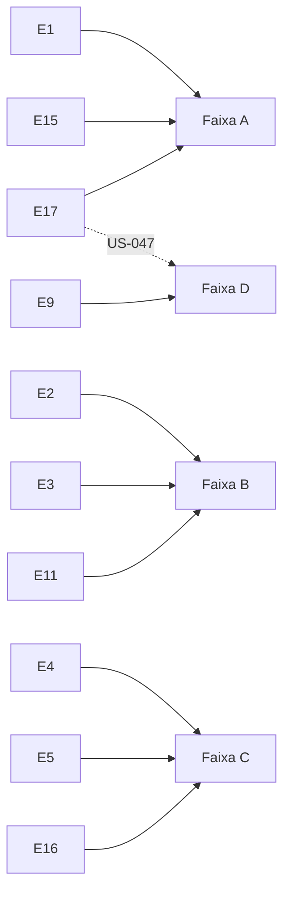

# Épicos

Fonte: `docs/requisitos/historias.md` (E1 a E17). Regra: só os épicos com histórias da fase H entram na [Sprint 01](sprints/sprint-01.md) (E1, E2, E3, E4, E5, E9, E11, E15, E16, E17). Os demais (E6, E7, E8, E10, E12, E13, E14) ficam integralmente pós-hackathon.

| Épico | Nome | Objetivo | Histórias fase H | Histórias pós-hackathon | Faixa dona | Tamanho total | Status |
|---|---|---|---|---|---|---|---|
| E1 | Conta e acesso | Cadastro, entrada e perfil inicial | US-001, 002, 004, 005 | US-003 | A | M | em sprint |
| E2 | Mapa e Trilhas | Ver e explorar o Mapa de conteúdos e a Trilha da plataforma | US-006, 009, 010 | - | B | M | em sprint |
| E3 | Jornada | Criar Jornada com meta e prazo | US-011 | - | B | G | em sprint |
| E4 | Estudo de conteúdo | Estudar com fonte e dominar pelo mini-simulado | US-012, 013 | US-017 | C | G | em sprint |
| E5 | Revisão | Revisar com flashcards | US-018 | US-033 | C | G | em sprint |
| E6 | Simulados | Resolver simulados e ver resultado | - | US-019, 020, 030 | - | G | refinar |
| E7 | Book | Anotações do aluno | - | US-023 | - | M | refinar |
| E8 | Mentor e custo | Mentor de IA e medição de custo e produto | - | US-007, 021, 022 | - | G | refinar |
| E9 | Redação | Retorno por IA pelas 5 competências, limite e sugestão de conteúdo | US-042, 043, 044 | US-025, 026 | D | G | em sprint |
| E10 | Papel e foto | Correção de material no papel e por foto | - | US-027, 028, 029 | - | G | refinar |
| E11 | Cronograma | Sessões de estudo geradas da Jornada | US-016 | US-031, 032 | B | M | em sprint |
| E12 | Planos e cobrança | Cotas, plano Plus e plano social | - | US-034, 035, 036 | - | G | refinar |
| E13 | Grupos | Grupos e desafios | - | US-037, 038, 039 | - | G | refinar |
| E14 | Professor | Trilhas do professor e acompanhamento | - | US-040, 041 | - | G | refinar |
| E15 | Início e Perfil | Início com próximos passos e Perfil | US-014 | US-015 | A | M | em sprint |
| E16 | Conteúdo e dados | Conteúdo com fonte e questões | US-049 | US-008, 024 | C | G | em sprint |
| E17 | Entrega do hackathon | Repositório, demo no ar, vídeo e seed | US-045, 046, 047, 048 | - | A (US-047: D) | M | em sprint |

Tamanho total: soma qualitativa dos tamanhos das histórias de cada épico (todas as fases).

Divergências de mapeamento: nenhuma de épico inexistente. Observações: US-007 "Medir produto" está em E8 (Mentor e custo), embora trate de métricas de produto; US-005 está em E1 com troca de área só na F5; US-047 (E17) é da faixa D, as demais de E17 são da A.
