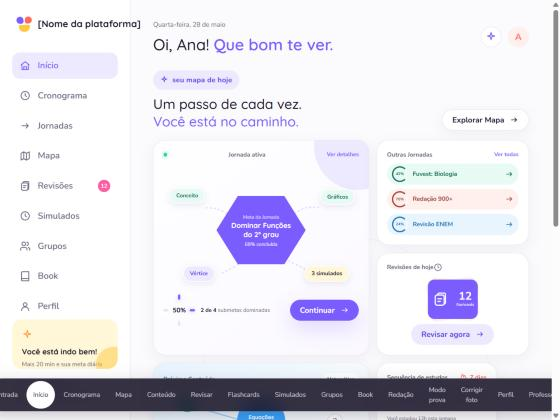
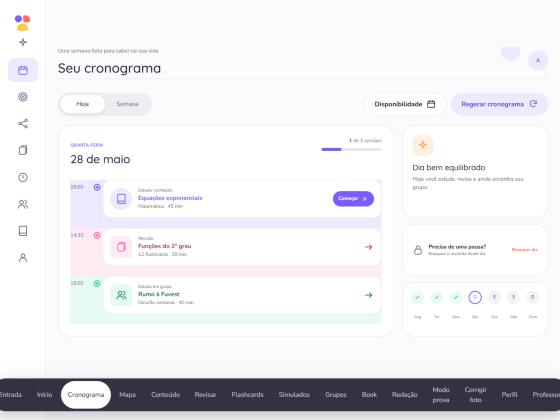
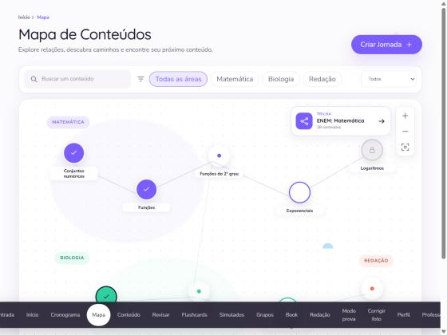
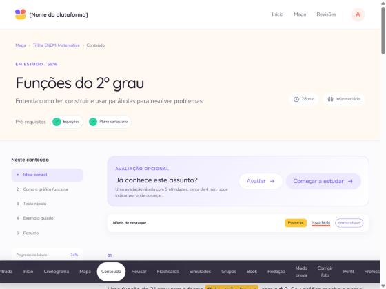
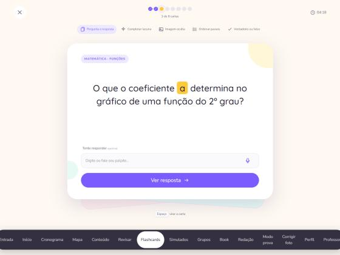
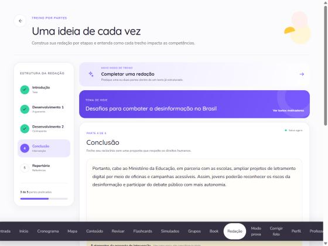

# Design do Aprumo: referência do protótipo Figma

Referência de implementação para os devs (Next.js + Tailwind). Imagens em `figma-prototipo/`.

## 1. Fonte e regra

- Protótipo: Figma Make publicado em https://object-study-60652393.figma.site/. Por decisão do PO, o design da aplicação **deve seguir** o protótipo.
- O protótipo é a referência **visual**. O Gherkin das histórias manda no **comportamento**. Em conflito, o dev relata ao PO e não decide sozinho.
- Os dados do protótipo (Ana, Fuvest etc.) são só ilustrativos. A demo usa os dados fictícios do seed.
- O texto "[Nome da plataforma]" vira "Aprumo".
- A barra de navegação de TESTE do protótipo (15 itens) **não é implementada**. A navegação real é o menu lateral do app.

## 2. Tokens (mapear no tema do Tailwind)

| Grupo | Token | Valor |
|---|---|---|
| Roxo | `--purple` / `--purple-dark` / `--purple-light` | #7b5cff / #6243e8 / #ede9ff |
| Coral | `--coral` / `--coral-light` | #ff6b5b / #fff0ed |
| Amarelo | `--yellow` / `--yellow-light` | #ffc93c / #fff7d8 |
| Menta | `--mint` / `--mint-light` | #2ed3a0 / #e8faf4 |
| Azul | `--blue` / `--blue-light` | #3ba4ff / #e8f5ff |
| Rosa | `--pink` / `--pink-light` | #ff5fa2 / #ffebf3 |
| Laranja | `--orange` / `--orange-light` | #ff9a3c / #fff0df |
| Neutros | `--cream` (fundo da página) / `--white` | #fff9f2 / #fff |
| Texto | `--ink` / `--muted` / `--line` | #1f1b2e / #6b6880 / #e9e5ef |
| Raios | `--r-sm` / `--r-md` / `--r-lg` / `--pill` | 8px / 16px / 24px / 999px |
| Sombras | `--shadow` | 0 12px 36px #49368c17 |
| | `--shadow-purple` | 0 15px 35px #7b5cff33 |

Nota de contraste: texto pequeno usa `purple-dark` (token `purple-text` no tema). #7b5cff tem 4,36:1 sobre branco e 3,67:1 sobre `purple-light`, abaixo de 4,5:1; `purple-dark` tem 6,02:1 e 5,08:1.

Tipografia (Google Fonts, via `next/font`): corpo **Nunito**; destaque e cartas **Quicksand**.

Mapa de Conteúdos, estados do nó:

| Estado | Visual |
|---|---|
| Não iniciado | vazado |
| Em estudo | anel roxo com ponto |
| Dominado | roxo preenchido com check |
| Bloqueado | cinza com cadeado |

Ligações: pré-requisito (linha cheia) e relacionado (tracejada).

Tema: não há tema escuro no protótipo. Na fase H, só modo claro (decisão a confirmar).

## 3. Telas da fase H

### 3.1 Entrada

| Item | Detalhe |
|---|---|
| História / faixa / rota | US-001 / A / `/` |
| Mostra | Cabeçalho com marca e links Como funciona, Explorar, Entrar. Título "Seu caminho de estudos, passo a passo." com "passo a passo." em roxo. Texto de apoio. Prova social. |
| Componentes | Botões "Começar agora" (roxo) e "Já tenho conta"; cartões flutuantes (próximo passo, sequência, evolução); formas orgânicas coloridas |
| Estados | Padrão; links e botões com foco e hover |

### 3.2 Início

| Item | Detalhe |
|---|---|
| História / faixa / rota | US-014 / A / `/inicio` |
| Mostra | Saudação "Oi, Ana! Que bom te ver."; cartão "Jornada ativa" (mini-grafo, meta, progresso, botão Continuar); "Outras Jornadas"; "Revisões de hoje" (12 flashcards, Revisar agora); "Próximo conteúdo" (Estudar); "Sequência de estudos"; "Mapa de Conteúdos" (Abrir Mapa) |
| Pós-hackathon | "Meta de simulado", "Grupo de estudo" |
| Menu lateral | Início, Cronograma, Jornadas, Mapa, Revisões. Pós: Simulados, Grupos, Perfil, Book |
| Estados | Carregando, vazio (sem Jornada ativa, sem revisões) e erro a definir pela faixa A |

### 3.3 Cronograma

| Item | Detalhe |
|---|---|
| História / faixa / rota | US-016 / B / `/cronograma` |
| Mostra | Título "Seu cronograma"; abas Hoje/Semana; botões Disponibilidade e Regerar cronograma; linha do tempo do dia; cartão "Dia bem equilibrado"; régua da semana |
| Sessões | "Estudar conteúdo" (botão Começar), "Revisão". Pós: "Estudo em grupo" |
| Pós-hackathon | "Bloquear dia" (ajustes são F4) |
| Estados | Dia sem sessões, carregando, erro ao regerar |

### 3.4 Mapa

| Item | Detalhe |
|---|---|
| Histórias / faixa / rota | US-006, US-009, US-010 / B / `/mapa` |
| Mostra | "Mapa de Conteúdos"; busca; chips de área (Todas as áreas, Matemática, Biologia, Redação); filtro de estado (Todos, Não iniciados, Em estudo, Dominados, Bloqueados); botão "Criar Jornada"; grafo com regiões por área; cartão da Trilha ("ENEM: Matemática, 18 conteúdos"); zoom; legenda |
| Fase H | Só a matéria Português/Redação (D-019). Os chips de área podem ficar só com a área da fase H |
| Estados | Nós nos 4 estados da seção 2; busca sem resultado; carregando |

### 3.5 Conteúdo

| Item | Detalhe |
|---|---|
| Histórias / faixa / rota | US-012, US-013 / C / `/conteudos/[slug]` |
| Mostra | Breadcrumb Mapa > Trilha > Conteúdo; selo "EM ESTUDO · 68%"; título; resumo; duração e nível; pré-requisitos como chips; índice lateral "Neste conteúdo" (Ideia central, Como o gráfico funciona, Teste rápido, Exemplo guiado, Resumo) com progresso de leitura; seções numeradas, cada uma com FONTE citada; "PAUSA RÁPIDA" com alternativas A/B/C e botão Conferir; níveis de destaque (Essencial, Importante, termo-chave) |
| Avaliação opcional | Cartão "Avaliação opcional": avaliação inicial é pós-hackathon; na H só o mini-simulado |
| Pós-hackathon | "Imprimir questão", vídeo, Book |
| Estados | Pergunta: não respondida, acerto, erro (anunciar com aria-live); conteúdo carregando ou inexistente |

### 3.6 Flashcards

| Item | Detalhe |
|---|---|
| História / faixa / rota | US-018 / C / `/revisar` |
| Mostra | Barra de progresso "3 de 8 cartas"; abas de tipos (na H só "Pergunta e resposta"); carta com matéria e tópico; "Tente responder (opcional)" com campo; botão "Ver resposta"; atalho Espaço para virar; confiança em 4 níveis (SABIA!, REVER, ...) |
| Estados | Frente, verso, sessão concluída, sem cartas hoje |

### 3.7 Redação

| Item | Detalhe |
|---|---|
| Histórias / faixa / rota | US-042, US-043, US-044 / D / `/redacao` |
| Mostra | Título "Uma ideia de cada vez"; etapas à esquerda (Introdução, Desenvolvimento 1 e 2, Conclusão, Repertório) com "3 de 5 partes praticadas"; cartão "Tema de hoje" com "Ver textos motivadores"; editor da parte com contador de caracteres e "Salvo agora"; apoio "5 elementos da proposta de intervenção"; botões "Guardar rascunho" e "Ver retorno desta parte" |
| Painel "RETORNO DA PARTE" | Competências relacionadas (C3, C5); "01 · PONTO FORTE"; "02 · PODE FICAR MAIS PRECISO", ambos com trechos citados; "Experimentar sugestão" |
| Cuidado (RN-023) | O retorno **nunca** reescreve o texto do aluno. "Experimentar sugestão" só aponta o caminho, sem entregar texto pronto |
| Divergência | A H tem 3 partes (RF-054); o protótipo tem 5 etapas (ver seção 6) |
| Estados | Rascunho salvo, salvando, retorno carregando, erro no retorno |

## 4. Telas do protótipo fora da fase H

Só a lista, sem implementação na H: Revisar (tipos de revisão), Simulados, Grupos, Book, Modo prova (nome proibido pelo RNF-020, não usar), Corrigir foto, Perfil, Professor.

## 5. Regras de implementação

| Tema | Regra |
|---|---|
| Componentes | Reutilizáveis em `src/components/ui` (faixa A), com os tokens no tema do Tailwind e fontes via `next/font` |
| Responsivo | O protótipo é desktop. No celular o menu lateral vira barra inferior ou menu (decisão da faixa A). Sem rolagem horizontal |
| Acessibilidade | Foco visível, teclado, `aria-live` nos estados assíncronos. Contraste: #7b5cff sobre branco é limitado em texto pequeno, verificar e usar `--purple-dark` quando necessário |
| "Fiel ao Figma" | Estrutura, cores, tipografia, espaçamento e componentes conferidos lado a lado com a imagem. Evidência em `docs/evidencias/faixa-x/` (screenshot da tela implementada ao lado da referência) |

## 6. Divergências conhecidas a confirmar com o PO

1. Redação: protótipo com 5 etapas (inclui repertório e desenvolvimento 2) x 3 partes no RF-054.
2. "Modo prova": nome proibido pelo RNF-020, não usar.
3. Nome "[Nome da plataforma]": substituir por "Aprumo".
4. Sem tema escuro: só modo claro na fase H.
5. Telas pós-hackathon: aparecem no protótipo, fora da H.
6. Mapa: protótipo com 3 áreas x uma matéria na H (D-019).
