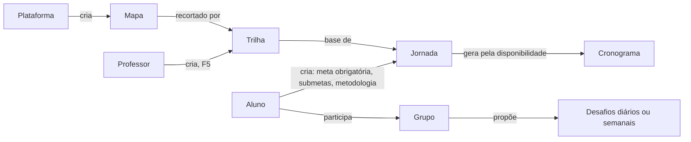
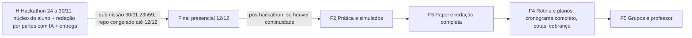
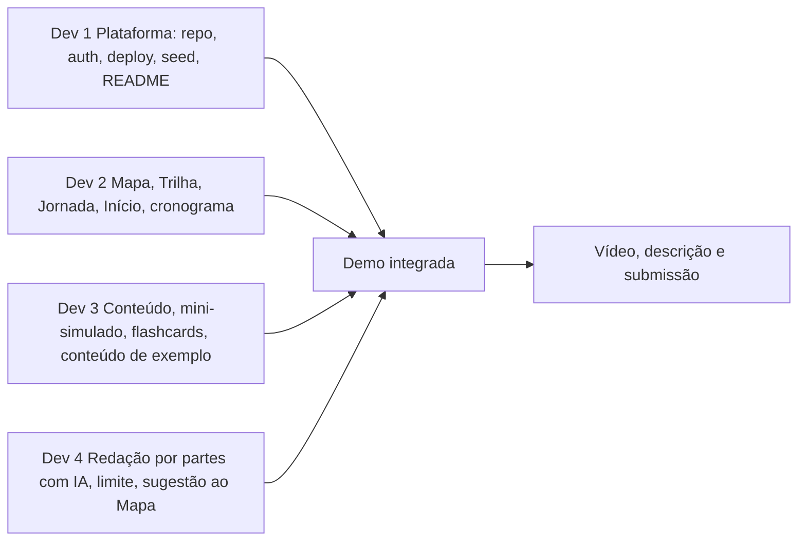

# Requisitos: plataforma de estudos (ENEM)

Fase vigente: **H, Hackathon Hack Brasil 2026**. Índice: [historias.md](historias.md) · [casos-de-uso.md](casos-de-uso.md) · [requisitos.md](requisitos.md) (RF, RNF, RN) · [rastreabilidade.md](rastreabilidade.md) · [backlog](../backlog/backlog.md) · [pendências](../backlog/pendencias.md) · [DoD](../definition-of-done.md).
Fonte: `docs/referencias/plataforma-estudos-fluxos-stack.md` (2026-11-20) e protótipo visual de 15 telas (Entrada, Início, Cronograma, Mapa, Conteúdo, Revisar, Flashcards, Simulados, Grupos, Book, Redação, Modo prova, Corrigir foto, Perfil, Professor). Nome provisório da plataforma: **Aprumo** (substitui Rumo e Veredas; D-015 resolvida como provisório, escolhido pelo PO em 2026-11-24; aceito pelo grupo sem verificação formal de domínio, repositório e marca, D-024 resolvida); landing "Seu plano. Seu ritmo. Seu futuro.".

## Visão e escopo

Objetivo de longo prazo: plataforma que orienta e corrige o estudo para o ENEM, com Mapa de conteúdos, Jornadas com meta, prática, simulados e correção, sem dar aulas.

**Fase atual: H, Hackathon Hack Brasil 2026** (mudança de contexto do PO em 2026-11-24; trilha "Acesso à educação"; regulamento em https://hackbrasil.com/regulamento). Os testes com 10 a 30 testadores e a medição de retenção não cabem e saem. A pontuação do júri (execução técnica, implementação técnica, impacto e comunicação, 0 a 10 cada, mínimo 20 de 40 para a final) substitui o critério de sucesso (D-004 descartada).

Restrições do regulamento: submissão até 30/11/2026 23h59; final presencial em 12/12 em São Paulo; repositório congelado entre 30/11 e 12/12; repositório novo e público (commits só após 04/11/2026 21h, sem fork nem código privado anterior); link de demo no ar; vídeo de até 3 min assistível sem login; descrição; demo sem dados pessoais reais de terceiros; proibida ferramenta para colar em prova ou burlar plágio (evitar o nome "Modo prova"; resolução completa só a pedido do aluno); equipe de 4 pessoas maiores de 18 anos. Jurados podem avaliar só por código, demo e vídeo. Hospedagem decidida: Vercel + Supabase, região São Paulo (D-009); stack final e plano contratado seguem com o arquiteto.

- Dentro do escopo (fase H): cadastro e login do aluno; Mapa de UMA matéria (Português/Redação, D-019) com ~15 a 20 conteúdos de exemplo; Trilha da plataforma; Jornada com meta e prazo; cronograma mínimo (US-016); estudar conteúdo (seções e pergunta rápida); mini-simulado de 5 questões e 80% (RN-007); nó acende no Mapa ao dominar; flashcards; Início; IA em destaque: redação por partes com retorno pelas 5 competências do ENEM, nota só como "estimativa" com aviso, limite de uso por aluno e competência fraca que sugere conteúdo do Mapa para a Jornada (US-042 a US-044); entrega: repositório, demo (conta fictícia pública e cadastro livre com aviso de dados de teste, D-021), vídeo, descrição e seed fictício (US-045 a US-049).
- Pós-hackathon (preservado, IDs mantidos): Grupos, Professor e criação de Trilhas, Book, planos, cobrança, cotas, CNPJ e plano social, modo prova, mapa mental, impressão, redação completa no papel, resolução por foto, cronograma completo, revisões além de flashcards, mentor de IA geral, medição de retenção e de testadores, consentimento de menores.
- Fora de escopo permanente: aulas em vídeo próprias como curso, app nativo, chat nos grupos, visão individual de alunos pelo professor.
- Premissas: sugestões sempre recusáveis; IA por API; dados fictícios na demo; conteúdo de exemplo escrito pelo time com fonte citada.
- Restrições: prazos do regulamento; stack final e plano de hospedagem ao arquiteto (D-009); custo de IA limitado (RNF-018); infraestrutura em planos gratuitos, só a IA é paga (RNF-022, RNF-023, D-025).

## Glossário
- Mapa: todos os conteúdos ligados por pré-requisito e relação; criado pela plataforma.
- Trilha: recorte do Mapa para um objetivo (ex.: ENEM: Matemática).
- Jornada: plano do aluno sobre uma Trilha ou conteúdos do Mapa, com meta obrigatória, submetas e metodologia.
- Cronograma: sessões geradas da Jornada pela disponibilidade.
- Grupo: aprende junto por meta coletiva ou matéria recorrente, com desafios e sem chat.
- Dominado: estado do conteúdo que acende o nó no Mapa (RN-007).
- Book: cadernos de notas com blocos referenciando Conteúdo > Seção.
- Plus: nome provisório do plano pago.

## Atores
Visitante; Aluno; Professor (um usuário pode ter os dois perfis); Editor de conteúdo (equipe da plataforma); Time de produto; Mentor de IA (sistema).

## Conceitos

## Fases

Fase H (vigente) e plano completo pós-hackathon:

Fatias da fase H para 4 devs (ver "Cronograma de 6 dias"):

| Fase | Histórias | Qtd |
|---|---|---|
| H | US-001, 002, 004, 005, 006, 009 a 014, 016, 018 (recortadas) + US-042 a US-049 (novas) | 21 |
| F0 | US-001 a US-008 (parte na H; US-003, 007, 008 pós) | 8 |
| F1 | US-009 a US-016 (US-015 pós) | 8 |
| F2 | US-017 a US-024 (US-018 na H) | 8 |
| F3 | US-025 a US-030 | 6 |
| F4 | US-031 a US-036 | 6 |
| F5 | US-037 a US-041 | 5 |

Fase H por tamanho: P 6 (US-001, 004, 010, 043, 045, 047); M 10 (US-002, 005, 006, 009, 013, 014, 016, 044, 046, 048); G 5 (US-011, 012, 018, 042, 049).

## Cronograma de 6 dias (24 a 30/11/2026)

Só as datas do regulamento são firmes: submissão até 30/11/2026 23h59 e repositório congelado de 30/11 a 12/12. Os marcos abaixo são metas internas de planejamento, não promessas. Recomenda-se submeter com folga e não na última hora.

| Dia | Marco |
|---|---|
| 1 (24/11) | Comparar 2 modelos de IA (D-010) e fixar o teto global provisório de custo (D-020); repositório novo e público criado; esqueleto, deploy vazio no ar, esquema de dados, matéria escolhida. |
| 2 (25/11) | Cadastro e login; Mapa e Trilha com seed; primeiros conteúdos de exemplo escritos (US-049 em paralelo até o dia 5). |
| 3 (26/11) | Jornada com meta e prazo; estudar conteúdo; mini-simulado e nó acendendo. |
| 4 (27/11) | Redação por partes com IA, 5 competências, aviso de estimativa e limite de uso; sugestão de conteúdo para a Jornada. |
| 5 (28/11) | Flashcards, Início e cronograma mínimo (cortáveis); integração; conteúdo de exemplo completo. |
| 6 (29/11) | Demo estável no ar, conta de demonstração, README, vídeo gravado, descrição pronta; congelar funcionalidades. |
| 30/11 | Submissão (prazo 23h59); apenas correções críticas antes dela. |

## Riscos
| ID | Risco | Mitigação |
|---|---|---|
| R-01 | Conteúdo com fonte sem responsável de produção e validação (não previsto na F0). | US-008, RNF-012, D-005. |
| R-02 | Custo de IA por aluno acima do previsto. | RNF-010, RNF-011, cotas (D-011). |
| R-03 | LGPD: fotos e dados de menores. | RNF-005, RNF-006, D-006, D-018. |
| R-04 | Leitura de fotos manuscritas imprecisa. | RN-015, D-008, D-010. |
| R-05 | (Substituído) Critério de sucesso agora é a nota do júri. | D-004 descartada. |
| R-06 | Licença de questões reais. | RF-031, D-005. |
| R-07 | (Mitigado) Cronograma só na F4 enfraquecia o núcleo da Jornada; versão mínima movida para a F1. | US-016, D-002 resolvida. |
| R-08 | Falta de CNPJ impede cobrança. | Pós-hackathon (D-012). |
| R-09 | Prazo de 6 dias com 4 devs: escopo não cabe. | Linha de corte: US-016, US-018, US-014; fatias independentes. |
| R-10 | Custo ou indisponibilidade da IA durante a avaliação. | RNF-018, RF-056, aviso sem erro técnico (US-046). |
| R-11 | Violação do regulamento (código anterior, dados reais, aparência de ferramenta de cola). | RNF-017, RNF-019, RNF-020, RNF-021, D-022. |
| R-12 | (Mitigado) Reaproveitar os docs atuais no repositório novo (criados após 04/11, sem código). | D-023 resolvida: podem ir; nenhum código anterior entra (RNF-019). |
| R-13 | Nome "Aprumo" pode colidir com domínio, repositório ou marca (não verificado). | Aceito pelo grupo sem verificação formal (D-024 resolvida, M-015); verificar só se fizer diferença. Risco residual aceito. |
| R-14 | Plano gratuito pausa o banco por inatividade ou não tem backup diário; limites do Free podem ser menores que o previsto. | RNF-022, RNF-023 (monitor externo, cron, dump manual diário de 29/11 a 12/12 e antes de cada `db push`; limites confirmados no dia 1), sem escala de plantão (qualquer integrante do grupo atende; ponto de atenção em D-029), D-025, D-027. |
| R-15 | Cobrança da IA acima do teto, se o limite de gasto não estiver configurado nos provedores. | RNF-018; D-026 resolvida (o grupo paga). Limite mensal configurado no console de cada provedor no dia 1; risco residual até essa configuração. |

## Perguntas em aberto
Todas viram D-nnn em [pendencias.md](../backlog/pendencias.md). Resolvidas em 2026-11-24: D-007, D-009, D-015 (provisório), D-019, D-021, D-022, D-023, D-024 (nome aceito pelo grupo, sem verificação formal), D-025 (infraestrutura em planos gratuitos, só a IA é paga), D-026 (o próprio grupo paga a IA; limite de gasto a configurar no dia 1), D-027 (dump diário por qualquer integrante do grupo, sem escala) e D-028 (login só por e-mail e senha na fase H; Google pós-hackathon) e D-029 (sem escala de plantão; qualquer integrante do grupo atende quando houver chamado; ponto de atenção em D-029). Em aberto na fase H: D-010 (modelo de IA; recomendação: comparar 2 modelos com ~5 redações fictícias no 1º dia); D-020 (só o teto global de custo: US$ 20 provisório, configurável, fixar no dia 1; limites já definidos: 3 por aluno por dia e 15 por dia na conta de demonstração); D-030 (regras de senha e recuperação na demo, sem confirmação de e-mail; a decidir antes de implementar o cadastro). D-004 descartada; D-011, D-012, D-013, D-014, D-016, D-017 pós-hackathon.
