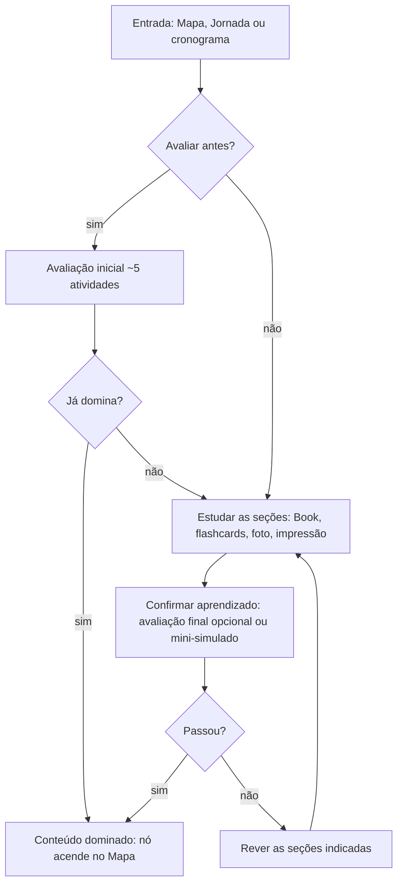

# Casos de uso

### UC-001 Primeiro acesso
- Ator: Visitante. Pré-condição: nenhuma.
- Fluxo principal: 1) vê a entrada e clica "Começar agora"; 2) cadastra com e-mail e senha (sem confirmação de e-mail na demo; Google pós-hackathon, D-028); 3) se menor de 18, conclui o consentimento; 4) escolhe Aluno ou Professor; 5) segue para Criar Jornada ou Minhas Trilhas.
- Alternativos/Exceção: 2a) e-mail já cadastrado: oferece entrar; 3a) consentimento recusado: conta não ativada.
- Pós-condição: conta ativa com um perfil.

### UC-002 Login e troca de área
- Ator: Usuário. Pré-condição: conta ativa.
- Fluxo principal: 1) faz login; 2) com um perfil vai à área; 2') com dois vê "Como você quer entrar hoje?"; 3) usa o menu para trocar de área.
- Exceção: 1a) credenciais inválidas: mensagem e nova tentativa.
- Pós-condição: usuário na área escolhida.

### UC-003 Criar Jornada
- Ator: Aluno. Pré-condição: perfil Aluno.
- Fluxo principal: 1) escolhe base (Trilha ou conteúdos do Mapa); 2) define meta e prazo; 3) escolhe metodologia ou nenhuma; 4) adiciona submetas (opcional); 5) escolhe nivelamento; 6) informa disponibilidade se ainda não houver; 7) revê mini-grafo e clica "Começar".
- Alternativos/Exceção: 2a) sem meta: não avança; 3a) recusa metodologia: segue sem; limite de Jornadas ativas: bloqueia.
- Pós-condição: Jornada ativa no Início e no Perfil.

### UC-004 Estudar um conteúdo
- Ator: Aluno. Pré-condição: conteúdo publicado.
- Fluxo principal: 1) entra pelo Mapa, Jornada ou cronograma; 2) aceita ou recusa a avaliação inicial; 3) se já domina, conteúdo dominado (fim); 4) estuda as seções; 5) confirma com avaliação final ou mini-simulado; 6) se passou, conteúdo dominado e nó acende.
- Alternativos/Exceção: 5a) não passou: vê seções a rever e volta ao passo 4; 4a) anota no Book, cria flashcards, imprime ou corrige foto.
- Pós-condição: estado do conteúdo atualizado no Mapa.

### UC-005 Revisar com flashcards
- Ator: Aluno. Pré-condição: flashcards disponíveis.
- Fluxo principal: 1) abre Revisar; 2) tenta responder; 3) vira; 4) avalia confiança (4 níveis); 5) repete; 6) vê nós acesos e próxima revisão agendada.
- Alternativo: nenhuma revisão pendente.
- Pós-condição: revisões reagendadas.

### UC-006 Fazer simulado
- Ator: Aluno. Pré-condição: cota disponível.
- Fluxo principal: 1) escolhe formato; 2) personaliza se for o caso; 3) resolve com cronômetro; 4) revisa e entrega; 5) vê resultado; 6) adiciona conteúdos fracos à Jornada.
- Alternativos/Exceção: 3a) salva e continua (exceto completo cronometrado); 1a) cota esgotada: aviso.
- Pós-condição: resultado no histórico do Perfil.

### UC-007 Corrigir resolução por foto
- Ator: Aluno. Pré-condição: cota e taxa mínima de leitura atingida.
- Fluxo principal: 1) clica "Corrigir minha resolução"; 2) captura a foto; 3) revisa a leitura; 4) vê etapas com estado e dica no primeiro erro; 5) pede resolução completa se quiser.
- Exceção: 3a) leitura abaixo da taxa: correção não liberada, nova foto.
- Pós-condição: resultado salvo; foto sujeita à retenção.

### UC-008 Redação no papel
- Ator: Aluno. Pré-condição: cota.
- Fluxo principal: 1) baixa a folha; 2) escreve com tempo; 3) digitaliza; 4) revisa a leitura; 5) recebe marcações e nota por competência; 6) "Treinar esta parte".
- Exceção: 4a) foto ilegível: nova foto sem consumir cota.
- Pós-condição: correção registrada.

### UC-009 Gerar cronograma
- Ator: Aluno. Pré-condição: Jornada ativa.
- Fluxo principal (F1, mínimo, US-016): 1) informa disponibilidade; 2) plataforma gera sessões a partir da Jornada; 4) clica "Começar sessão" no dia.
- Fluxo principal (F4, US-031): como acima, com sessões por tipo seguindo a metodologia (passo 2) e 3) ajuste das sessões.
- Alternativos: 3a) pede para regerar (F4); 1a) sem Jornada ativa: convite para criar uma.
- Pós-condição: cronograma vigente.

### UC-010 Pergunta aberta em grupo
- Ator: Membro do grupo. Pré-condição: grupo com pergunta aberta (F5).
- Fluxo principal: 1) responde; 2) se errou ou chegou perto, desbloqueia a resposta de colega que acertou; 3) marca e reage.
- Exceção: ninguém acertou: sem resposta a desbloquear.
- Pós-condição: resultados da semana atualizados. Não há chat.

### UC-011 Criar Trilha (Professor)
- Ator: Professor. Pré-condição: perfil Professor (F5).
- Fluxo principal: 1) clica "Criar Trilha"; 2) informa nome, objetivo, cor; 3) seleciona conteúdos no Mapa; 4) ordena e confere pré-requisitos; 5) publica; 6) acompanha dados agregados.
- Exceção: 4a) violação de pré-requisito: alerta.
- Pós-condição: Trilha publicada com selo "Professor".

### UC-012 Assinar plano Plus
- Ator: Aluno. Pré-condição: F4.
- Fluxo principal: 1) vê cotas; 2) escolhe mensal ou anual; 3) paga por Pix Automático ou cartão; 4) cotas ampliadas.
- Exceção: 3a) pagamento recusado; cancelamento em até 7 dias com reembolso.
- Pós-condição: plano ativo.

### Diagrama: fluxo central (UC-004)

### UC-013 Treinar redação por partes (fase H)
- Ator: Aluno. Pré-condição: conta ativa e uso restante no limite.
- Fluxo principal: 1) escolhe tema e parte; 2) escreve e envia; 3) vê o estado "corrigindo"; 4) recebe retorno pelas 5 competências com nota rotulada "estimativa" e aviso; 5) vê a competência fraca com conteúdo sugerido do Mapa; 6) clica "Adicionar à Jornada".
- Alternativos/Exceção: 2a) texto curto: orientação, sem consumir uso; 3a) falha da IA: erro e nova tentativa sem consumir uso; 1a) limite esgotado: aviso, sem chamar a IA; 5a) sem conteúdo correspondente: sem sugestão; 6a) sem Jornada: vai a Criar Jornada.
- Pós-condição: uso contabilizado só em retorno entregue; conteúdo opcionalmente na Jornada.
